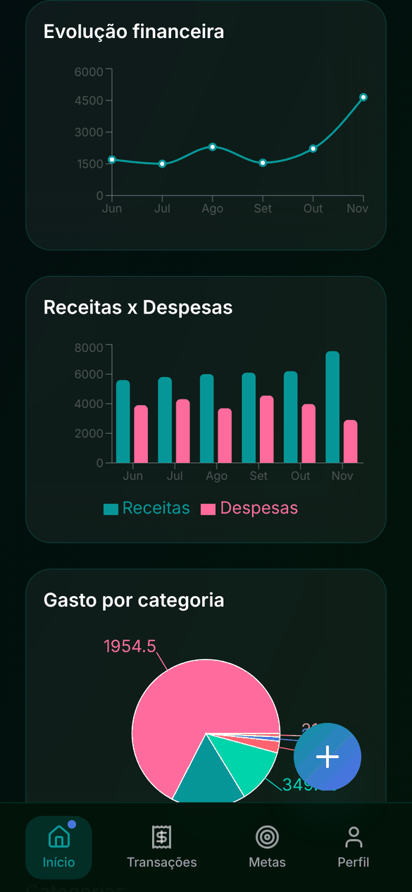
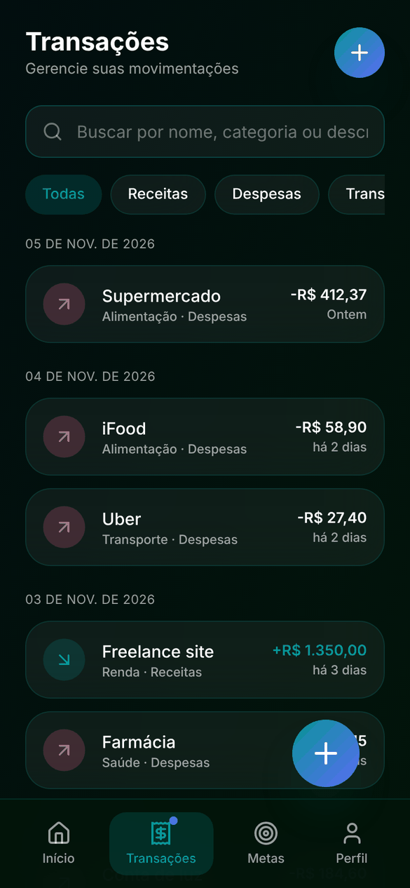
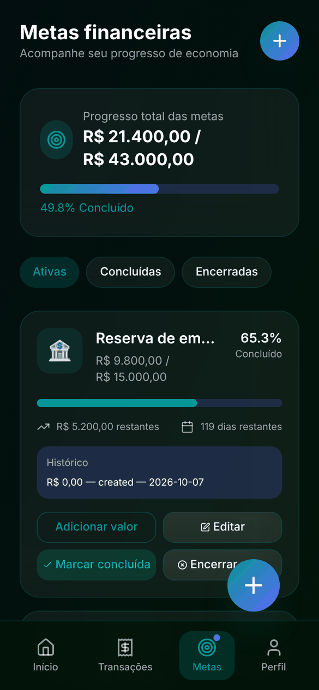
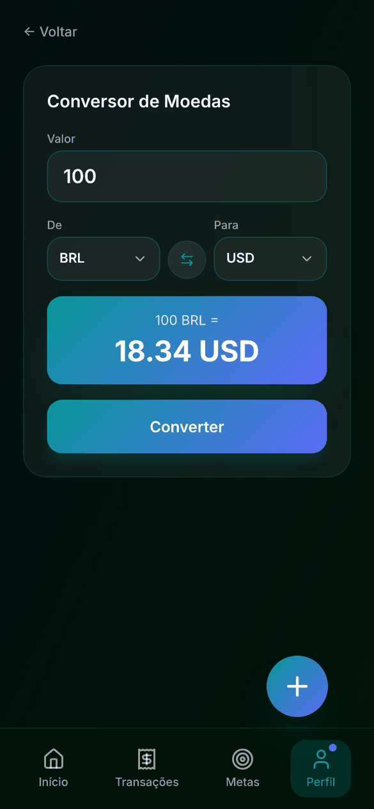

<div align="center">

# 💸 FinanceFlow

**Seu dinheiro organizado, direto do celular.**

Aplicativo web de finanças pessoais com interface *mobile-first*, desenvolvido com React, TypeScript e Firebase.


[Funcionalidades](#-funcionalidades) •
[Telas](#-telas) •
[Tecnologias](#️-tecnologias) •
[Como executar](#-como-executar) •
[Firebase](#-configuração-do-firebase) •
[Estrutura](#-estrutura-do-projeto) •
[Roadmap](#️-roadmap)

</div>

---

## 📱 Funcionalidades

| | |
|---|---|
| 📊 **Dashboard** | Receitas, despesas e saldo total em tempo real, com gráficos por categoria e comparação mensal |
| 💳 **Transações** | Registro de receitas, despesas e transferências, com busca e filtros por tipo, categoria, período e valor |
| 🎯 **Metas financeiras** | Crie metas, acompanhe o progresso e registre aportes |
| 🏆 **Conquistas** | Desbloqueie conquistas conforme avança nas metas |
| 💱 **Conversor de moedas** | Cotações atualizadas pela API Frankfurter |
| 📄 **Relatórios** | Exportação das transações em CSV e PDF |
| 👤 **Perfil** | Foto, dados pessoais, cartões e preferências |
| 🌗 **Tema claro e escuro** | Alternância com um toque |
| 🌍 **Idiomas** | Português e Inglês |

---

## 📸 Telas

<table align="center">
  <tr>
    <td align="center" width="260"><b>Login</b><br /><br /></td>
    <td align="center" width="260"><b>Dashboard</b><br /><br /></td>
    <td align="center" width="260"><b>Gráficos</b><br /><br /></td>
  </tr>
  <tr>
    <td align="center" width="260"><b>Transações</b><br /><br /></td>
    <td align="center" width="260"><b>Metas</b><br /><br /></td>
    <td align="center" width="260"><b>Conversor de moedas</b><br /><br /></td>
  </tr>
  <tr>
    <td align="center" width="260"><b>Perfil</b><br /><br /></td>
    <td align="center" width="260"><b>Tema claro</b><br /><br /></td>
  </tr>
</table>

<p align="center"><sub>Telas com dados de demonstração.</sub></p>

---

## 🛠️ Tecnologias

| Tecnologia | Uso no projeto |
|---|---|
| [React 18](https://react.dev) | Biblioteca de interface |
| [TypeScript](https://www.typescriptlang.org) | Tipagem estática |
| [Vite](https://vite.dev) | Bundler e servidor de desenvolvimento |
| [Tailwind CSS](https://tailwindcss.com) | Estilização |
| [Firebase Auth](https://firebase.google.com/docs/auth) | Autenticação de usuários |
| [Cloud Firestore](https://firebase.google.com/docs/firestore) | Banco de dados em nuvem |
| [Motion](https://motion.dev) | Animações |
| [Recharts](https://recharts.org) | Gráficos financeiros |
| [Lucide React](https://lucide.dev) | Ícones |

### 🌐 API externa: Frankfurter

O conversor usa a [Frankfurter API](https://frankfurter.dev), gratuita e sem necessidade de chave de acesso.

| Endpoint | Para que serve |
|---|---|
| `GET https://api.frankfurter.dev/v2/currencies` | Lista as moedas disponíveis |
| `GET https://api.frankfurter.dev/v2/rates?base=BRL&quotes=USD` | Cotação entre duas moedas |

Nenhuma configuração extra é necessária para usar esta API.

---

## 🚀 Como executar

**Pré-requisitos:** [Node.js](https://nodejs.org) 18 ou superior e um projeto no Firebase ([veja abaixo](#-configuração-do-firebase)).

```bash
# 1. Clone o repositório
git clone https://github.com/Victor-Hugo-Guilherme-Matheus/Finance-Flow.git
cd Finance-Flow

# 2. Instale as dependências
npm install

# 3. Configure as variáveis de ambiente
cp .env.example .env   # e preencha com os dados do seu Firebase

# 4. Rode em modo de desenvolvimento
npm run dev
```

Para gerar a versão de produção: `npm run build`.

---

## 🔥 Configuração do Firebase

<details>
<summary><b>Clique para ver o passo a passo</b></summary>

### 1. Crie um projeto
Acesse o [console do Firebase](https://console.firebase.google.com) e crie um novo projeto.

### 2. Ative os serviços
- **Authentication** → E-mail/senha
- **Firestore Database** → Modo de produção → Região `southamerica-east1`

### 3. Registre o app web e configure o `.env`
No console, clique em **Adicionar app** → ícone Web (`</>`) e copie os dados da configuração do SDK para o arquivo `.env`:

```env
VITE_FIREBASE_API_KEY=
VITE_FIREBASE_AUTH_DOMAIN=
VITE_FIREBASE_PROJECT_ID=
VITE_FIREBASE_STORAGE_BUCKET=
VITE_FIREBASE_MESSAGING_SENDER_ID=
VITE_FIREBASE_APP_ID=
```

> O arquivo `.env` não é enviado ao GitHub. Se publicar o app (Vercel, Netlify etc.), cadastre as mesmas variáveis no painel da hospedagem.

### 4. Publique as regras de segurança
As regras em `firestore.rules` garantem que cada usuário só acesse os próprios dados:

```bash
npm install -g firebase-tools
firebase login
firebase deploy --only firestore
```

</details>

---

## 🔒 Segurança

- Cada usuário só lê e altera os próprios dados (regras em `firestore.rules`)
- Chaves do Firebase ficam no `.env`, fora do repositório
- Cartões guardam apenas os 4 últimos dígitos; número completo e CVV nunca são salvos

---

## 📂 Estrutura do projeto

```
src/
├── app/
│   ├── App.tsx            # Navegação entre telas
│   └── components/        # Telas, modais e componentes de interface
├── context/               # Estado global (autenticação e finanças)
├── i18n/                  # Traduções PT/EN
├── services/              # Firebase, câmbio e upload de foto
├── styles/                # Tema e estilos globais
├── theme/                 # Tema claro/escuro
├── types/                 # Tipos TypeScript
└── utils/                 # Formatação, validação, cálculos e relatórios
```

---

## 🗺️ Roadmap

- [x] Regras de segurança do Firestore
- [x] Configuração do Firebase via `.env`
- [x] Cartões sem dados sensíveis
- [ ] Recuperação de senha pelo Firebase
- [ ] App instalável (PWA) e modo offline
- [ ] Orçamento por categoria com alertas
- [ ] Fatura de cartão, parcelamento e contas recorrentes
- [ ] Importação de extrato (OFX/CSV)

---

## 👥 Equipe

<table>
  <tr>
    <td align="center" width="140">
      <a href="https://github.com/ViktorHSO">
        <br />
        <b>Victor Hugo</b>
      </a>
    </td>
    <td align="center" width="140">
      <a href="https://github.com/guilherme07O">
        <br />
        <b>Guilherme</b>
      </a>
    </td>
    <td align="center" width="140">
      <br />
      <b>Matheus</b>
    </td>
  </tr>
</table>
